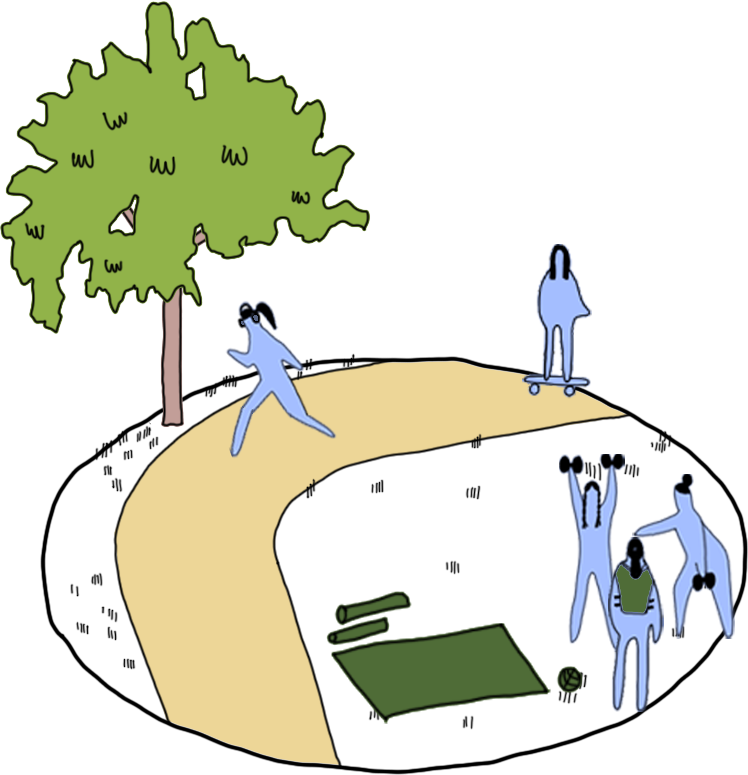
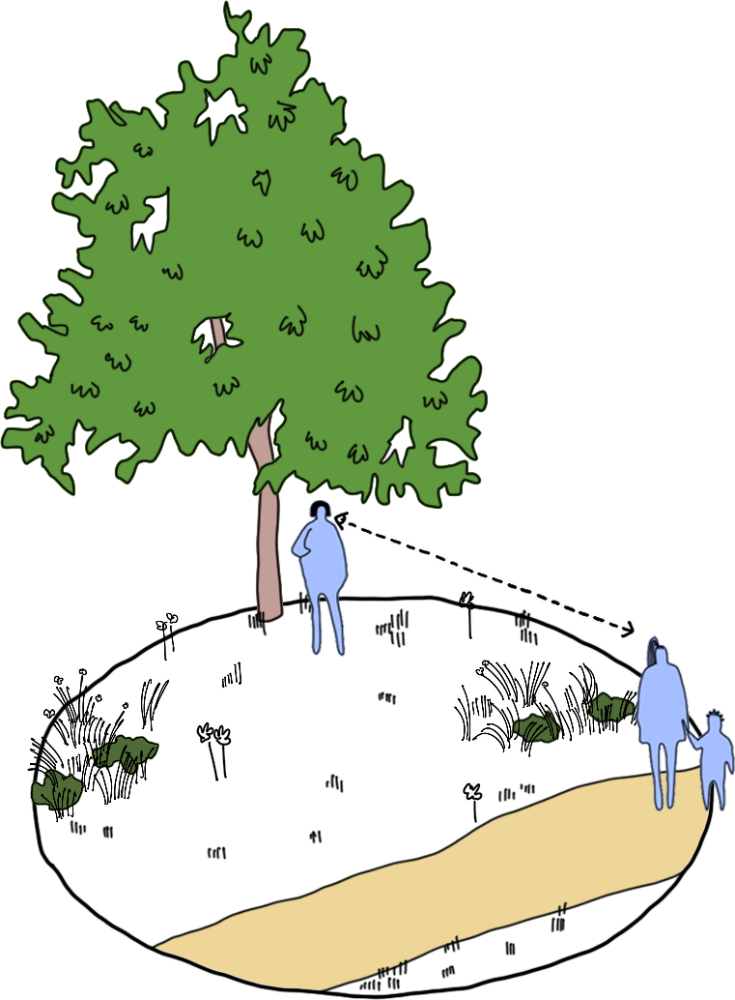
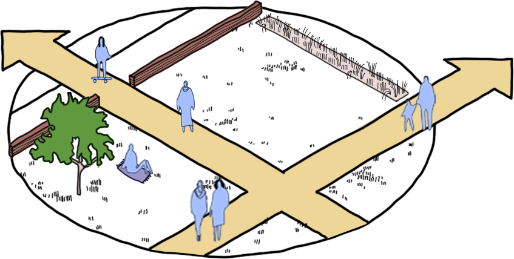

## Evidence-informed insights for safer and more inclusive parks

:::{.text-box3}
A free mapping tool that helps practitioners understand the environmental and social factors that influence how safe women and girls feel in parks and green spaces.
Developed by an interdisciplinary research team at the University of Leeds, the dashboard combines open spatial data, advanced geospatial analysis and the principles set out in [*Safer Parks: Improving Access for Women and Girls*](https://eprints.whiterose.ac.uk/id/eprint/229530/1/250908_Safer%20Parks_PCPI_Single.pdf) to support evidence-informed decision-making.

The dashboard has been designed for local authorities, park managers, planners, police forces, community safety partnerships, landscape professionals and community organisations seeking to improve safety, accessibility and inclusion in parks across England and Wales.

:::{style="text-align:center"}

](assets/guidance.png){width="40%" fig-align="center" alt="Cover of the Safer Parks guidance document, showing a sketch of a park with trees, paths, and benches."}
:::

Using the dashboard, partners can: 

::::{.column-page-inset-right}

- Identify areas where improvements to lighting, visibility or access may be beneficial
- Explore park entrances, access points and potential escape routes
- Understand likely movement patterns through parks
- Review park facilities and amenities
- Support Environmental Visual Audits, park management plans and investment decisions
- Inform local approaches to preventing violence against women and girls (VAWG)
::::

The dashboard is intended to complement local knowledge, site visits, community engagement and other sources of evidence, rather than replace them.

; illustration credit: [Harper Perry](www.harperperry.co.uk).](assets/Safer-Parks-Strategy-Harper-Perry-05.jpg){fig-align="center" width="90%" fig-alt="Overview sketch of a park with trees, paths, benches, and a playground. The sketch is annotated with arrows and text highlighting entrances, escape routes, and areas of visibility."}

## The Evidence Base

:::{.text-box3}

The dashboard is grounded in *Safer Parks: Improving Access for Women and Girls*, national guidance developed through extensive research and engagement with women and girls, parks professionals, police forces, urban designers and other stakeholders.

The guidance identifies ten principles that contribute to safer and more inclusive parks, organised around three interconnected themes.

:::

 

:::: {.column-page-inset}
::: {.grid}

::: {.g-col-12 .g-col-md-4}

::: {.text-box-eyes}
### Eyes on the Park 

Parks often feel safer when they are active, welcoming and well used. Regular activity creates opportunities for natural surveillance while visible staff, volunteers and other legitimate users can provide reassurance and support.

::: {.larger-bullets2}

- Busyness and Activation
- Staffing and Authority Figures

:::

:::
:::
  
::: {.g-col-12 .g-col-md-4}

::: {.text-box-aware}
### Awareness 

People are more likely to feel safe when they can easily understand their surroundings. Visibility, lighting, clear routes and good park layouts help reduce uncertainty and increase confidence in using the space.

::: {.larger-bullets2}

- Visibility and Openness
- Escape
- Lighting
- Wayfinding and Layout

:::

:::

:::

::: {.g-col-12 .g-col-md-4}

:::{.text-box-incl}
### Inclusion 

Safety is closely linked to belonging. Parks should feel welcoming to diverse users and be shaped through ongoing engagement with the communities they serve.

::: {.larger-bullets2}

- Belonging and Familiarity
- Image
- Access and Location
- Co-production and Engagement

:::

:::

:::
  
:::

<!-- ::: {.grid}

::: {.g-col-12 .g-col-md-4 .img-box}

{width="80%" fig-align="center" fig-alt="A sketch of a park with exercise classes with personal trainers taking place."}

:::
  
::: {.g-col-12 .g-col-md-4 .img-box}

{width="80%" fig-align="center" fig-alt="A sketch of a park showing sightlines and visibility through shrubbery and trees."}

:::

::: {.g-col-12 .g-col-md-4 .img-box}

{width="85%" fig-align="center" fig-alt="A sketch of a park with multiple exists highlighted."}

:::

:::

::: {.grid}

::: {.g-col-12 .g-col-md-4 .text-box-eyes2}

- Encouraging regular business users, such as personal trainers, can make the space feel safer.
- Classes in the park can include a wide range of activities, not just exercise.
- Promoting active travel increases overall use of the park.

:::
  
::: {.g-col-12 .g-col-md-4 .text-box-aware2}

- Raising the height of tree canopies and planting low bushes by paths improves visibility.
- Hills and mounds with an S-shaped profile creates better visibility.
- Building in hills or other high places can give good prospect around.

:::

::: {.g-col-12 .g-col-md-4 .text-box-incl2}

- A choice of routes and exits improves the feeling of safety.
- The entrances to a park should be wide and clearly visible.
- Fenced areas feel very unsafe to teenage girls so other design approaches are more inclusive.

:::

::: -->

::::

 

Three themes/ten guiding principles from the [*Safer Parks: Improving Access for Women and Girls* guidance](https://www.makespaceforgirls.co.uk/resources/safer-parks-for-women-and-girls-guidance); illustrations by [Harper Perry](www.harperperry.co.uk).

:::{.text-box3}

## From Guidance to Action

The dashboard translates these principles into a series of spatial indicators and interactive data layers that can be explored at national, regional and site level.

These include:

- Visibility modelling
- Lighting provision
- Park entrances and access points
- Predicted route popularity
- Tree and vegetation cover
- Park facilities and amenities
- Active travel connections
- Population and neighbourhood characteristics

By combining multiple datasets, users can develop a more comprehensive understanding of how different factors interact to influence people's experiences of parks.

For example, a well-used route may suffer from poor visibility, while an entrance with high levels of use may lack adequate lighting or natural surveillance. Bringing these layers together helps identify priorities for intervention and support more informed decision-making.

The dashboard has been developed through ongoing collaboration with local authorities, police forces, parks professionals and community partners to ensure it addresses real-world operational challenges.
Together, the Safer Parks guidance and the dashboard provide a practical framework for creating parks that feel safer, more welcoming and more inclusive for women and girls.

:::

