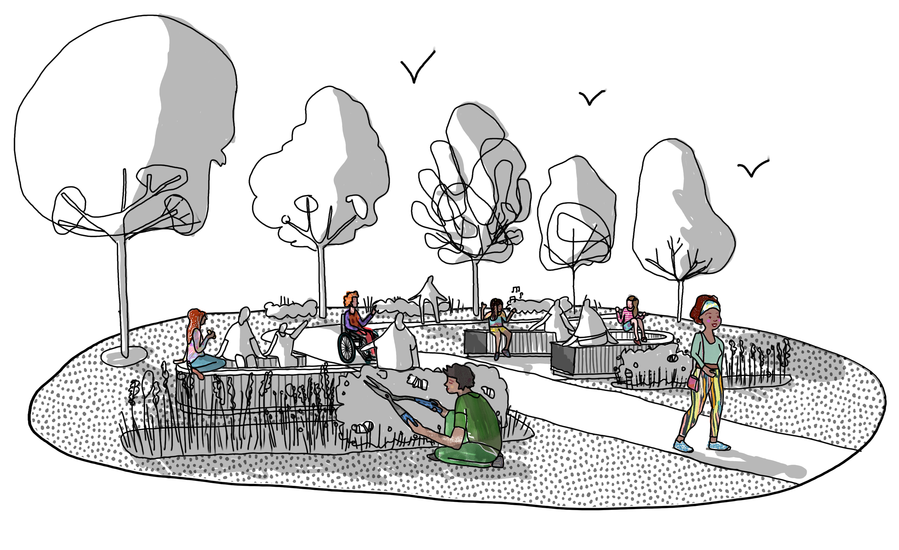

# Welcome to the Safer Parks Dashboard!

[Supporting safer, more inclusive parks for women and girls]{.emphasis}

[A free mapping tool that brings together open data and spatial insights to help practitioners understand the factors that shape safety and inclusion in parks across England and Wales.]{.emphasis3}

::::{.grid}

::: {.g-col-12 .g-col-md-6 .align-items-center}

:::::{.larger-bullets}
Use the dashboard to:

- Visualise park safety factors
- Explore spatial data layers
- Make decisions with evidence
- Create safer parks in your area
:::::

:::

::: {.g-col-12 .g-col-md-6 .align-items-center}
{fig-align="center" width="100%"}
:::

::::

::::{.d-flex .justify-content-center}
[Register to access the dashboard](https://forms.cloud.microsoft/Pages/ResponsePage.aspx?id=qO3qvR3IzkWGPlIypTW3y_21PdTtSidAqW-TSzvWOgxUNzlNSDBOWFBSN1JQM0YzUEhYUDdTOE5TNC4u){.btn .btn-primary .btn-lg .rounded-pill}
::::

::: {.text-box}

[Want to see how the Safer Parks Dashboard works?]{.emphasis}

[Join our next free 30-minute [online session](events.qmd) to see the dashboard in action and ask the people who built it questions.]{.emphasis3}

:::

 

  
Warranty and liability (click to expand)

  The software is provided "as is", without warranty of any kind, express or implied, including but not limited to the warranties of merchantability, fitness for a particular purpose and noninfringement. In no event shall the authors or copyright holders be liable for any claim, damages or other liability, whether in an action of contract, tort or otherwise, arising from, out of or in connection with the software or the use or other dealings in the software.

Hero section illustration credit: [Harper Perry](www.harperperry.co.uk).

