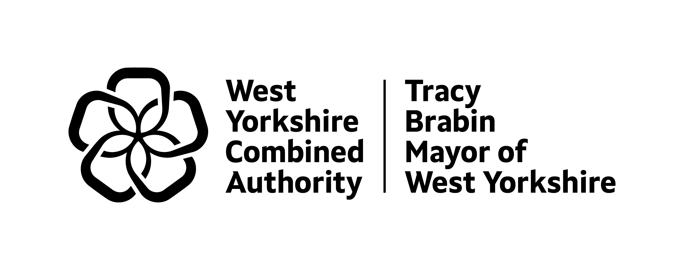
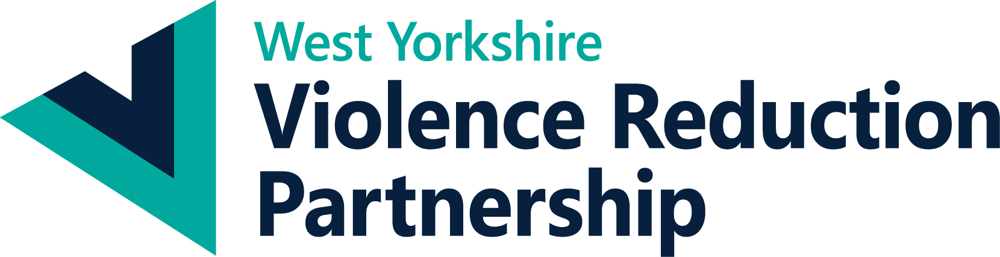
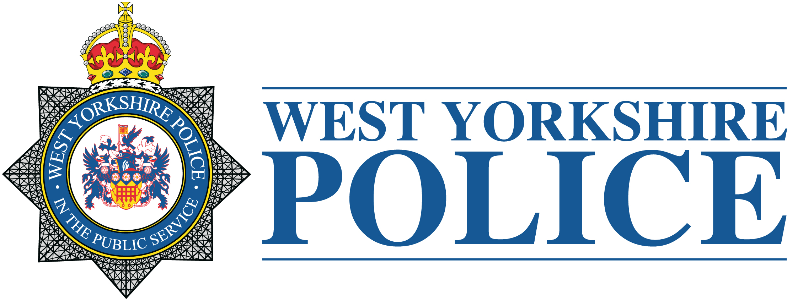
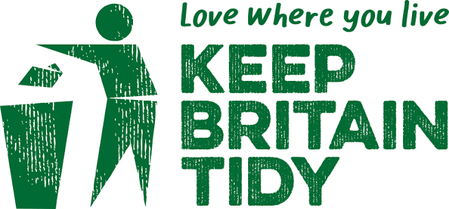
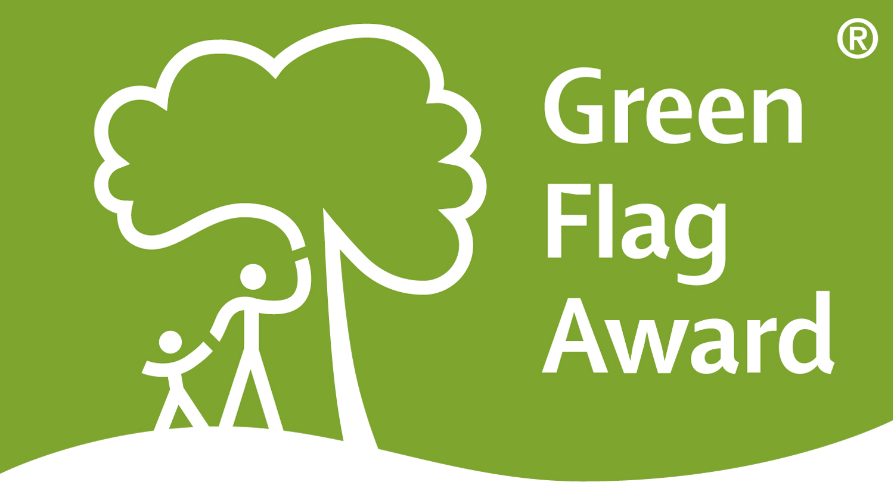
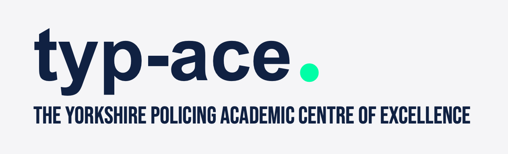
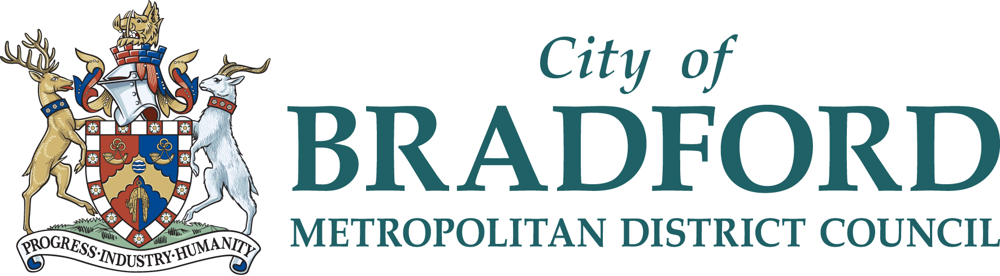
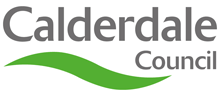
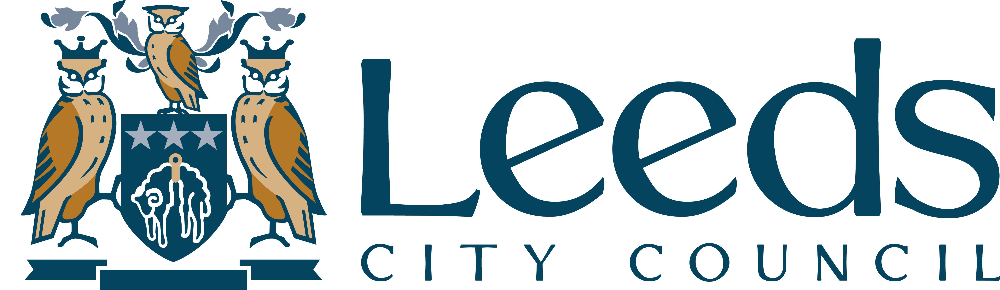
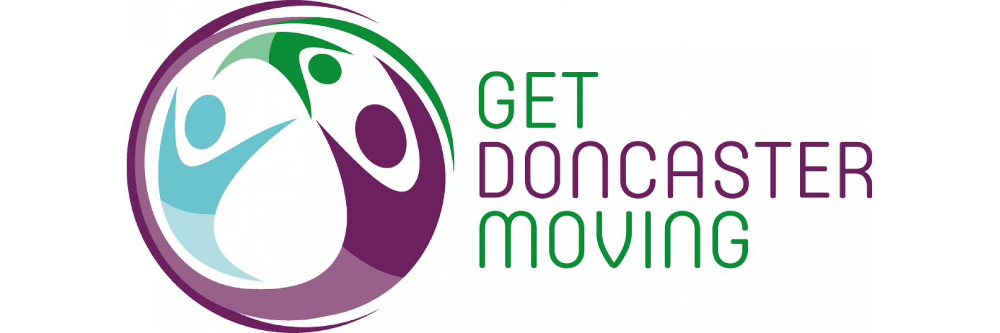

## Research Team

{fig-align="center" width="100%" alt="Safer Parks Dashboard research team"}

- Dr Anna Barker
  - Internationally recognised expert in women’s safety in public spaces and parks.
  - [Associate Professor in Criminal Justice & Criminology](https://essl.leeds.ac.uk/law/staff/177/dr-anna-barker)

- Dr Fran Pontin
  - Urban data scientist specialising in open data, dashboards, and spatial inequalities
  - [Lecturer & Senior Research Fellow](https://environment.leeds.ac.uk/geography/staff/8970/dr-fran-pontin)

- Dr Maeve Murphy Quinlan
  - Research software engineer leading open-source dashboard and scalable tool development. 
  - [Reserach Software Engineer](https://arc.leeds.ac.uk/team/maeve-murphy-quinlan/)

- Dr Vikki Houlden
  - Urban data scientist focusing on inclusive greenspace, wellbeing, and spatial inequalities. 
  - [Associate Professor in Urban Data Science](https://environment.leeds.ac.uk/geography/staff/9618/dr-vikki-houlden)

- Dr Melissa Barrientos
  - Spatial design specialist developing gender-sensitive metrics for park safety.
  - [Research Fellow](https://www.researchgate.net/profile/Melissa-Barrientos)

[Collaboration driving safer public spaces ]{.emphasis}

The Safer Parks Dashboard has been developed through close collaboration with partners, funders and supporters committed to improving safety, access and inclusion in parks, who have contributed expertise, resources and guidance throughout the project.

## Partners and Funders

::: {.carousel}

{fig-align="center" width="100%" alt="West Yorkshire Combined Authority logo"}

{fig-align="center" width="100%" alt="West Yorkshire Violence Reduction Partnership logo"}

{fig-align="center" width="100%" alt="West Yorkshire Police logo"}

{fig-align="center" width="100%" alt="Crime prevention initiative logo"}

{fig-align="center" width="60%" alt="Secured by Design logo"}

{fig-align="center" width="100%" alt="Keep Britain Tidy logo"}

{fig-align="center" width="100%" alt="Green Flag Award logo"}

{fig-align="center" width="100%" alt="Vulnerability and Policing Research Centre logo"}

{fig-align="center" width="100%"}

{fig-align="center" width="100%" alt="Bradford Council logo"}

{fig-align="center" width="100%" alt="Calderdale Council logo"}

{fig-align="center" width="100%" alt="Kirklees Council logo"}

{fig-align="center" width="100%" alt="Leeds Council logo"}

{fig-align="center" width="100%" alt="Wakefield Council logo"}

{fig-align="center" width="100%" alt="UKRI logo"}

{fig-align="center" width="100%" alt="Policy Leeds logo"}

{fig-align="center" width="100%" alt="University of Leeds logo"}

:::

 

## Supporters

::: {.carousel}

{fig-align="center" width="100%" alt="Active Travel England logo"}

{fig-align="center" width="100%" alt="Get Doncaster Moving logo"}

{fig-align="center" width="100%" alt="Gwent Police logo"}

{fig-align="center" width="100%" alt="In her place logo"}

{fig-align="center" width="100%" alt="Leeds Beckett University logo"}

{fig-align="center" width="100%" alt="Light Follows Behaviour logo"}

.png){fig-align="center" width="100%" alt="Make Space for Girls logo"}

{fig-align="center" width="100%" alt="Parks for London logo"}

{fig-align="center" width="100%" alt="Planit logo"}

{fig-align="center" width="100%" alt="Ryder logo"}

.svg){fig-align="center" width="100%" alt="Science and technology in policing logo"}

.jpg){fig-align="center" width="100%" alt="Southwark Council logo"}

{fig-align="center" width="100%" alt="Urban Design Group logo"}

:::

If you wish to show your support for the dashboard with your logo, please let us know!

 

## Illustrations and brand identity

 

::: {layout="[50, 50]" layout-valign="bottom" style="text-align: center;"}

](assets/partners/Harper Perry Logo_RGB_Colour.png){fig-align="center" height="180px" alt="Harper Perry logo"}

](assets/partners/Bike woman copy.png){fig-align="center" height="250px" alt="Illustration of a woman on a bike"}

:::

 

 

If you wish to show your support for the dashboard with your logo, please let us know!

